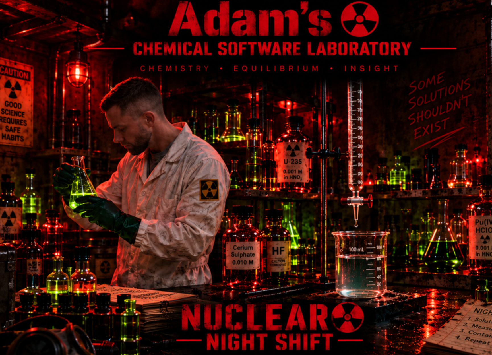

# Adam’s Laboratory

**Chemical engineering, explored.**

A personal collection of scientific tools, interactive experiments and creative projects by **Adam Britts**. Build a chemical system, explore its equilibrium, and take a prepared sample into the Wet Lab.

[Explore the website](https://adambritts23-create.github.io/adambritts-site/) · [Open Chemical Equilibrium](https://adambritts23-create.github.io/adambritts-site/laboratory/) · [Downloads](https://github.com/adambritts23-create/adambritts-site/releases)



*The laboratory artwork sets the atmosphere. Calculated results come from the scientific models.*

## The collection

| Workspace | What you can explore | Availability |
| --- | --- | --- |
| **Chemical Equilibrium · Calculation** | Beaker-based composition, speciation, combined solubility curves, supported Pourbaix/predominance maps and response surfaces | [Open in browser](https://adambritts23-create.github.io/adambritts-site/laboratory/) |
| **Chemical Equilibrium · Wet Lab** | Interactive acid/base and supported redox titrations, with sample transfer from Calculation | Inside Chemical Equilibrium |
| **Electrochemistry** | Karl Fischer titration and Fluoride ISE simulations | [Open workspace](https://adambritts23-create.github.io/adambritts-site/laboratory/?area=electrochemistry) |
| **Adam’s Laboratory · The game** | A separate playable laboratory world | [Windows preview releases](https://github.com/adambritts23-create/adambritts-site/releases) |
| **Reaction Engineering** | A reserved home for future development | Placeholder; no application yet |

## Start exploring

1. Open **Chemical Equilibrium** and let the thermodynamic database load.
2. Click the beaker to choose elements and component forms. Set their analytical totals beside it.
3. Choose a diagram and axis conditions. For **Log solubilities**, select the components you want to compare on the same graph.
4. Select **Plot diagram**, then inspect individual calculated samples alongside the beaker.
5. Use **Send to Wet Lab →** to transfer a sample. From a selected accepted calculation point, the transfer includes its pH and the whole analytical inventory, including precipitated material. Review the sample volume and prepare the experiment in Wet Lab.

Calculation totals normally use **mol/kg H₂O**. Transfer to Wet Lab uses an explicit water-mass-per-volume assumption, defaulting to **1 kg water per litre**. This is an approximation that can be changed, not a general equivalence between molality and molarity.

For the Windows game preview, download the ZIP from Releases, extract the complete folder, and open `AdamsLaboratory.exe`.

## Scientific approach

- Equilibria use the selected source reactions, component balances and supported phase constraints. Solid amounts follow stoichiometry.
- The main calculation engine currently uses **ideal activities at 25 °C and a declared pressure of 1 bar**. Nonideal activity corrections and general temperature/pressure dependence are not implemented in this path.
- Combined solubility curves share the **same mixed-system equilibrium**. They represent total dissolved component at accepted solid saturation, rather than the amount of a particular precipitate.
- Unsaturated solubility samples, failed calculations and unsupported conditions remain explicit. Missing values are not filled with invented equilibria.
- Pourbaix and predominance support depends on the selected chemistry and available metadata. The application distinguishes independently reference-validated conditions from internally verified calculations.
- Beaker graphics are schematic. Their appearance is not a quantitative prediction of solution colour, particle size or precipitation kinetics.

Thermodynamic records retain their source references and provenance from the Spana/MEDUSA/DataBase ecosystem associated with **Ignasi Puigdomenech**. These records were not authored by Adam. The application’s solver is separate; selected calculations are checked against independent **HaltaFall** reference results.

### Calculation performance

Interactive sweeps and maps reuse neighbouring solutions and likely solid phases. Each point still passes the existing scientific acceptance checks. Difficult or near-degenerate cases fall back to the exhaustive phase search.

Local measurements for the October 2026 optimization:

| Example | Independent exhaustive path | Optimized path |
| --- | ---: | ---: |
| Cr³⁺ / Fe²⁺ / Fe³⁺, each at 1 mol/kg H₂O; 101 points over pH 0–14 | 9.8 s | 0.12 s |
| Mn pH/Eh grid; 195 points | 1.18 s | 0.33 s |

These are local calculation timings, not browser rendering guarantees. The release passed **847 development tests**, including numerical comparisons, phase-boundary checks, reverse traversal, cancellation and reference-map checks. Thermodynamic constants and scientific acceptance tolerances were not relaxed for speed.

## About this repository

This is the **GitHub Pages publication repository**. It contains the homepage, assets and compiled browser application. The full React/Vite development project and its scientific test suite are maintained separately; this checkout is not the complete application build source.

```text
index.html       Homepage and collection
home.css         Homepage styling
topic-icons/     Topic artwork
laboratory/      Published chemistry application and supporting assets
README.md        This GitHub introduction
```

The live site is served from `index.html`; this README is not embedded in the website or added to its navigation.

### Preview the published site locally

Clone this repository, then run the following from its **parent directory**, keeping the checkout named `adambritts-site`:

```sh
python -m http.server 8000 --bind 127.0.0.1
```

Open `http://127.0.0.1:8000/adambritts-site/`. Serving from the parent preserves the application’s `/adambritts-site/laboratory/` asset paths. No Node.js build is needed to preview the published files.

## Feedback

[Report an issue](https://github.com/adambritts23-create/adambritts-site/issues) with the selected components, totals and units, diagram type, axis ranges, and any displayed error. A screenshot helps reproduce UI problems; exact conditions help reproduce chemistry problems.

---

Built around an engineer’s curiosity: chemistry, equilibrium, and the bigger process picture.

### Walkable laboratory

[Enter the walkable lab](https://adambritts23-create.github.io/adambritts-site/laboratory/?floor=upper), also available beside Calculation and Wet Lab in Chemical Equilibrium. It uses the current shared chemistry tools and includes Adam’s apartment through **Adam’s Home**. Walk with WASD or arrow keys, drag to look, and use **E** at a workstation. The downloadable game remains a separate experience.
